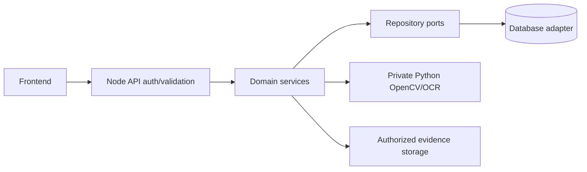

# Architecture

Node22/Express5: Route → Authenticate/Authorize/CSRF → Sanitize/Validate → Controller → Service → Repository → Sequelize/Database. `createApp` adalah factory tanpa listener; `server.js` mengelola lifecycle. `src` memakai nama folder template Denso. Tidak ada runtime `sync()`, DDL atau rawSQL; schema QueryInterface adalah skrip deployment di luar `src`.

Python3.12: internal API → image/analysis service → offline OCR/OpenCV. Tidak memiliki provider cloud atau database bisnis. Node mengirim snapshot master/kalibrasi, menautkan IDs publik ke user/context, dan menyimpan hanya konfirmasi operator. Python private loopback + service secret. Satu worker CPU dan satu instance API.

Tables: SPM_M_User, Instrument, Calibration, MaintenanceDefinition, Setting, Schema; SPM_T_Reading, MaintenanceRecord, Audit. Each has ID/created_at/payload with explicit indexed lookup columns. Domain snapshots use JSON text for portability; exact final decimal values use strings. Equipment1→many calibrations/readings; maintenance record snapshots definition+context and references confirmed reading IDs. Repository methods select explicit columns and SQL-level bounded limits.

Temporary images/jobs/results expire after900s/restart. Original photo bytes preserve provenance. One active job owns one EXIF-oriented decode; no decoded-photo global cache. A16-entry operation OCR cache reuses identical bytes but preserves independent variants; registry snapshot once per batch. Global template-feature and repeated pixel-pass caching were deferred pending separate evidence. Queue max5; upload15MiB/20MP; image store96MiB compressed-byte budget does not represent total native process memory.

Public API/evidence DTOs omit database connection fields and filesystem paths. Recognition heuristics remain baselinehybrid-cv-v0.2.3. Analog is limited to black needle0–1MPa; digital unit/profile/decimal/leading-digit/minus proof remains mandatory. No ground-truth claims are derived from operator corrections or screenshots alone.
