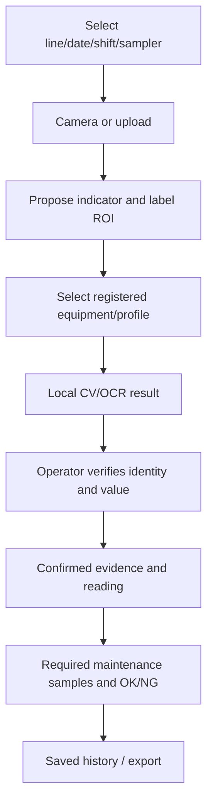

# General Information · Sparkplug Maintenance

Purpose: replace manual measurement notebooks/check sheets with operator-confirmed photo readings and digital maintenance OK/NG records for Spark Plug Final Assy.

Scope: offline digital OCR/seven-segment reading, black-needle analog0–1MPa, auto-crop/label suggestions, registered equipment matching, immutable calibration, audited confirmation,44 reviewed maintenance definitions, configuration/history/export. No cloud AI quota/key. A small integration page is supplied; final frontend and company deployment are separate.

Users: Viewer reads/exports; Operator captures/analyses/verifies/records; Admin manages equipment/calibrations/maintenance parameters. Account provisioning follows deployment scripts; company identity/SSO policy integration remains an external gate.

Benefits sought: clearer measurement provenance, explicit verification and specification checks, bounded local processing without per-image cloud cost. Accuracy is assessed through regression fixtures and operator/reference validation; no blanket90%field claim is made for arbitrary photos or hidden digits/needles.

Known source gaps: missing checklist17–23, clipped45, unresolved corporate database/SQL guidance/source-publication interpretation. Source access is internal; no automatic public publication. Human PIC, mentor, DX approval and UAT sign-offs are pending actual assignment.
